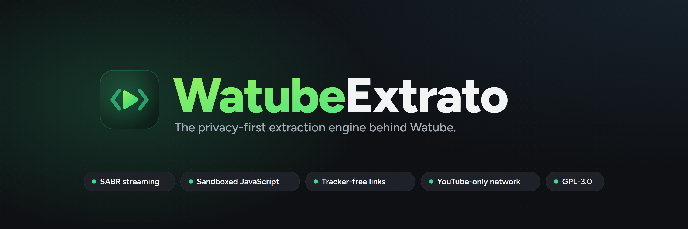

<div align="center">

  

  <br><br>

  

  <h1>WatubeExtrato</h1>

  <p>
    <b>The privacy-first extraction engine behind <a href="https://github.com/Lycaon-Project/Watube">Watube</a>.</b><br>
    <sub>A hardened fork of <a href="https://github.com/TeamNewPipe/NewPipeExtractor">NewPipe Extractor</a>, kept in sync with upstream.</sub>
  </p>

  <p>
    <a href="https://github.com/Lycaon-Project/WatubeExtrato/actions/workflows/ci.yml"></a>
    <a href="https://jitpack.io/#Lycaon-Project/WatubeExtrato"></a>
    
    <a href="https://www.gnu.org/licenses/gpl-3.0.en.html"></a>
  </p>

</div>

---

## 🇬🇧 What it is

WatubeExtrato reads public data from streaming sites (videos, channels, playlists, comments,
search, streams) without any account, API key or proprietary library. It is the engine of the
Watube Android app and follows NewPipe Extractor closely, with one goal on top: **nothing the
app sends or receives should expose its user more than strictly needed.**

## 🇫🇷 Ce que c'est

WatubeExtrato lit les données publiques des sites de streaming (vidéos, chaînes, playlists,
commentaires, recherche, flux) sans compte, sans clé d'API et sans bibliothèque propriétaire.
C'est le moteur de l'application Android Watube. Il suit de près NewPipe Extractor, avec un
objectif en plus : **rien de ce que l'application envoie ou reçoit ne doit exposer son
utilisateur plus que le strict nécessaire.**

---

## What differs from NewPipe Extractor / Différences avec NewPipe Extractor

| | NewPipe Extractor | WatubeExtrato |
|---|---|---|
| **SABR streaming** (YouTube's server-driven format) | not yet | ✅ supported (from the LibreTube work) |
| **YouTube JavaScript** | Rhino, interpreted | ✅ sandbox: 5 s limit, bounded stack, no Java access |
| **Player JavaScript origin** | not checked | ✅ only `https://www.youtube.com`, redirects included |
| **Streaming URLs** (video, HLS, SABR, DASH) | used as received | ✅ only `https://*.googlevideo.com` |
| **Links in descriptions and comments** | YouTube redirect unwrapped | ✅ unwrapped **and** tracking parameters removed |
| **Playback nonces** | `java.util.Random` | ✅ `SecureRandom`, unpredictable |
| **PoToken plumbing** | present (inactive) | ✅ removed |
| **Shared caches** | `HashMap` | ✅ thread safe and bounded |
| **Per-item parsing** (measured) | 360 ns / 710 ns | ✅ 190 ns / 235 ns (regexes compiled once) |
| **CI** | red (11 failing tests) | ✅ green, failures documented |

The fork merges upstream regularly: every fix and service update of NewPipe Extractor lands
here, the privacy and security layer stays on top.

---

## 🔒 Security / Sécurité

- **Network boundary.** Streaming URLs coming from a response are only fetched or played when
  they point to YouTube's video servers over https. Every DASH manifest redirect is checked,
  so a tampered response cannot send the client anywhere else.
  <br><sub>🇫🇷 Les URL de flux reçues ne sont utilisées que si elles mènent en https aux serveurs
  vidéo de YouTube ; chaque redirection du manifeste DASH est vérifiée.</sub>
- **Code from the network runs in a sandbox.** The deobfuscation functions of YouTube's player
  run in Rhino in interpreted mode with a run time limit, a stack limit and every Java class
  refused. An application can plug its own engine through `JavaScript.setExternalJavaScriptInterpreter`.
  <br><sub>🇫🇷 Le JavaScript de YouTube s'exécute dans un bac à sable (5 s, pile bornée, aucun
  accès Java).</sub>
- **Supply chain.** CI actions pinned by commit hash, Gradle wrapper checksum verified,
  Dependabot updates, dependencies checked against the OSV vulnerability database (no known
  CVE in the runtime or test dependencies as of 2026-10-27).
  <br><sub>🇫🇷 Actions CI épinglées par empreinte, wrapper Gradle vérifié, dépendances sans CVE
  connue (base OSV, 27/10/2026).</sub>

See [SECURITY.md](SECURITY.md) to report a vulnerability.

## 🕶️ Privacy / Vie privée

- **Tracker-free links**: `utm_*`, `fbclid`, `gclid`, `msclkid`, `igshid`… are removed from the
  links found in descriptions and comments, plus `si`, `pp` and `feature` on YouTube's own links.
  <br><sub>🇫🇷 Les paramètres de pistage sont retirés des liens.</sub>
- **No click tracking**: YouTube redirect links are opened directly, so YouTube never learns
  which link was followed.
- **Unlinkable sessions**: a fresh visitor identity for each player request, unpredictable
  playback nonces, `utcOffsetMinutes` sent as 0 (no time zone), consent cookie set to
  "reject all" by default, no console logging.
- **No telemetry**: no statistics, playback tracking or attestation endpoint is ever called.

> [!NOTE]
> The [Watube](https://github.com/Lycaon-Project/Watube) app adds its own layer around the
> extractor: a downloader that only reaches YouTube over https (checked on every redirect),
> responses capped in size, and no cookie storage.

---

## Usage / Utilisation

WatubeExtrato is published through [JitPack](https://jitpack.io/#Lycaon-Project/WatubeExtrato).
Use a **full commit hash**: JitPack keeps a "not found" answer per version string.

```kotlin
// settings.gradle.kts
dependencyResolutionManagement {
    repositories {
        mavenCentral()
        maven(url = "https://jitpack.io")
    }
}

// build.gradle.kts
dependencies {
    implementation("com.github.Lycaon-Project:WatubeExtrato:<full commit hash>")
}
```

With R8 / ProGuard, keep Rhino:

```
-keep class org.mozilla.javascript.** { *; }
-keep class org.mozilla.classfile.ClassFileWriter
-dontwarn org.mozilla.javascript.tools.**
```

> [!NOTE]
> Below `minSdk` 33, Android projects need
> [core library desugaring](https://developer.android.com/studio/write/java8-support#library-desugaring)
> with the `desugar_jdk_libs_nio` artifact.

### Test a local change / Tester une modification locale

```kotlin
// settings.gradle.kts of the app
includeBuild("../WatubeExtrato") {
    dependencySubstitution {
        substitute(module("com.github.Lycaon-Project:WatubeExtrato")).using(project(":extractor"))
    }
}
```

---

## Development / Développement

- **JDK**: the library compiles with a Java 17 toolchain, Checkstyle runs on Java 21; both are
  installed by the CI.
- **Tests**: `./gradlew check -Ddownloader=MOCK` runs the whole suite on recorded responses,
  without any network access. `-Ddownloader=REAL` runs it against the live sites (manual CI
  run only: GitHub's addresses are bot-checked by YouTube).
- **Upstream sync**: `git fetch upstream dev`, merge, then run `check`. Recorded mocks come
  from upstream; tests broken upstream as well are disabled with their reason.

## Supported sites / Sites pris en charge

YouTube (used by Watube, where the hardening above applies), SoundCloud, media.ccc.de,
PeerTube (no P2P) and Bandcamp, as in NewPipe Extractor.

## Credits / Remerciements

- [NewPipe e.V. and TeamNewPipe](https://github.com/TeamNewPipe/NewPipeExtractor): NewPipe Extractor, the base of this project.
- [LibreTube](https://github.com/libre-tube) and [FineFindus](https://github.com/FineFindus): SABR and visionOS client support.

## License / Licence

[](https://www.gnu.org/licenses/gpl-3.0.en.html)

WatubeExtrato is Free Software: you can use, study, share and improve it at your will.
Specifically you can redistribute and/or modify it under the terms of the
[GNU General Public License](https://www.gnu.org/licenses/gpl.html) as published by the
Free Software Foundation, either version 3 of the License, or (at your option) any later
version.

<sub>🇫🇷 WatubeExtrato est un logiciel libre sous licence GPL-3.0 ou ultérieure, comme NewPipe Extractor.</sub>
